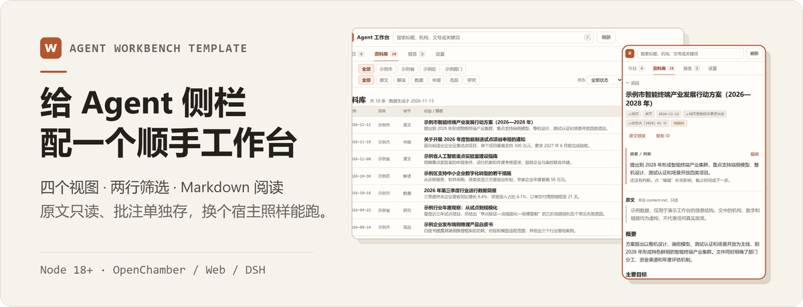
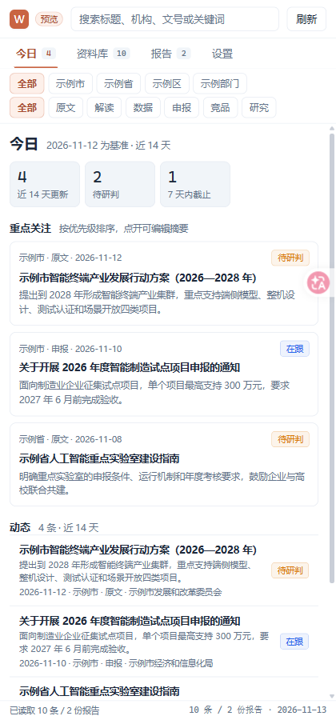
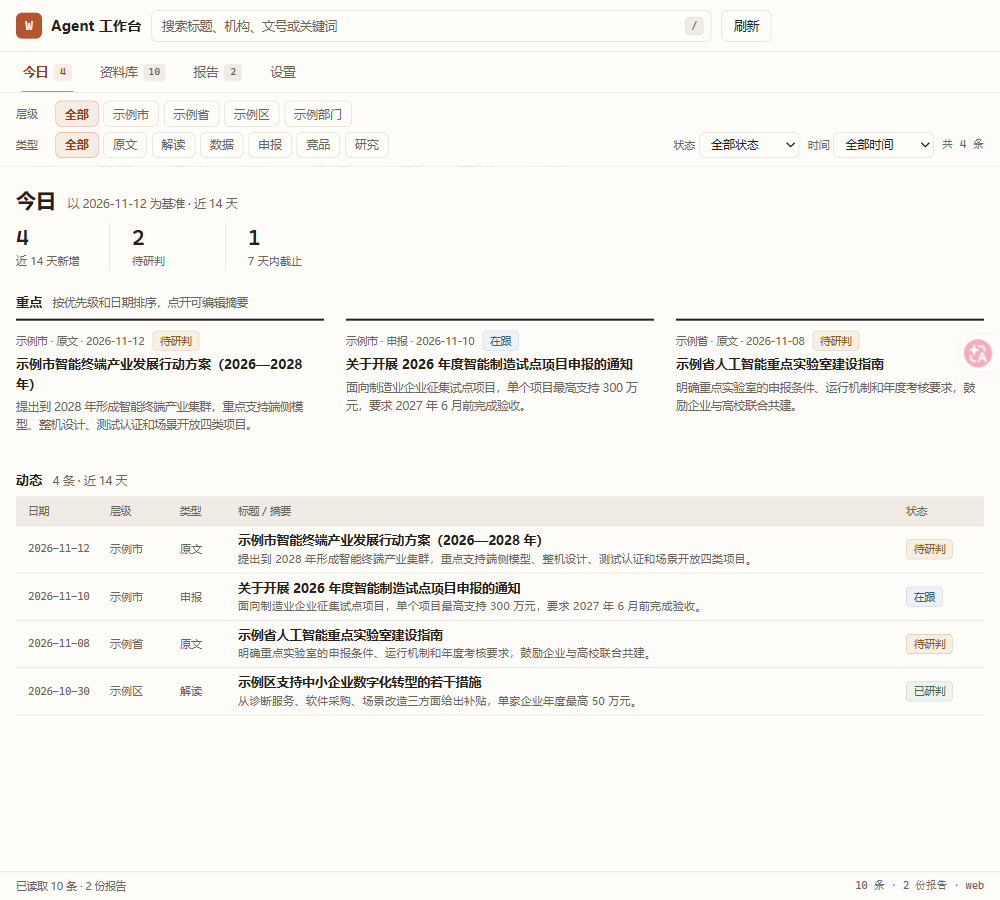
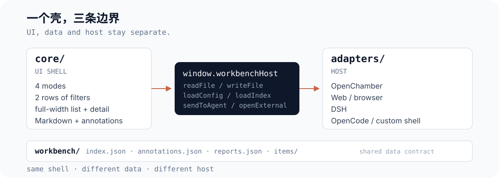

<p align="center">
  
</p>

# Agent Workbench Template

**English** | [中文](README.md)

A lightweight workbench template that drops into an agent side panel. No build or bundle step — a static server is enough. It gives you a solid layer for browsing lists, filtering, reading source text, and writing annotations.

`Node 18+` · `Zero build dependencies` · `Works with OpenChamber / Web / DSH / OpenCode`

## Four views when it opens

<p align="center">
  
</p>

- **Today**: new items in the last 14 days, the number awaiting review, and near-deadline items — so you don't start from the full list every time.
- **Library**: the two tag rows combine filters; the list below uses the full width. At 420px, the filter bar scrolls horizontally instead of breaking the layout.
- **Detail & annotations**: the source is rendered read-only from `content.md`; your summaries, judgments, and status are written to `annotations.json`. Re-exporting the data source later will not lose your notes.
- **Reports & settings**: weekly reports and collections in one place; send the current item to the agent in the conversation, or check host API status.

<details>
<summary>More screenshots (OpenChamber 420px sidebar &amp; 1000px Today view)</summary>

<p align="center">
  
  
</p>

The organizations, policies, and numbers in the example are fictional.

</details>

## Run it in 5 minutes

No dependencies to install, no bundling:

```bash
node server/server.mjs
```

Open <http://127.0.0.1:8787> and try these four steps:

1. On **Today**, look at the stats and focus items.
2. Switch to **Library**: click "示例市" (Example City) in the first row and "申报" (application) in the second, and watch the list filter.
3. Open any item, click **Edit** in the annotation box above, change a few judgments, and press `Ctrl/Cmd+S` to save.
4. Narrow the browser window to **420px**: the list stays a clean single column, and both the filter bar and the bottom action bar scroll horizontally.

After saving, look at `workbench/annotations.json`: the annotation is there, and the corresponding `workbench/items/<id>/content.md` has not changed by a single byte.

## Who it is for, and who it is not for

If you want to track policies, sales leads, story ideas, candidates, or literature notes in your agent's side panel, or you want a clean shell to turn into your own host plugin, this template is ready to adapt.

If you want a ready-made SaaS admin with login, multi-user permissions, and database full-text search, this won't help — there is no multi-level folder tree on the left and no backend database. It only does the "browse, filter, read, annotate, send to agent" layer well.

## Why it is split this way

- **Tabs follow usage scenarios, not content categories**: "Today / Library / Reports / Settings" answers "what am I doing now"; "which level, what type" is left to the second filter row, so changing industries doesn't require changing the tab structure.
- **Source text and annotations are stored separately**: fetched `content.md` is always read-only; human judgments go into `annotations.json` (atomically written via `PUT /api/annotations`). Months later, you can tell at a glance what the source said and what you concluded.
- **420px narrow-panel usability comes first**: line heights, spacing, and horizontal action bars are tuned for sidebar width. When the narrow layout works, the wide one stays clean. Only one warm terracotta accent marks focus; no pile of shadows and gradients.

## Plugging it into your own project

<p align="center">
  
</p>

All UI logic lives in `core/`; it never touches a platform-specific API directly, only a thin `window.workbenchHost`:

```js
window.workbenchHost = {
  loadIndex, loadAnnotations, saveAnnotations,
  loadItem, sendToAgent, openExternal, copyText
};
```

- **Use the web version directly**: run `node server/server.mjs`; the Web adapter is built in.
- **Install into OpenChamber**: load the extension from [`adapters/openchamber`](adapters/openchamber), set the project root to this repo's root, and grant `files / prompt / plugin` permissions. Start `node server/server.mjs` first so local source links open correctly.
- **Hook up DSH / OpenCode or your own desktop shell**: implement the methods above per [docs/host-api.md](docs/host-api.md), or embed the web version in a webview.

## Replace the content with yours

1. **Change the title and filters**: edit `title`, `labels`, `dimensions`, `types`, and `statuses` in `workbench/config.json`.
2. **Swap the data files**: put source text in `workbench/items/<id>/content.md`, the item index in `workbench/index.json` (point to it with `content_path`), and reports/collections in `reports.json`.
3. **Tune it for different scenarios**: [docs/customization.md](docs/customization.md) has six field mappings — policy, sales, recruiting, research, operations, and content. Change the config accordingly; you usually don't need to touch `core/`.

## Known limitations

- The pure web version has no chat window; "let the agent analyze / put in conversation / send" falls back to copying to the clipboard with a notice.
- The server listens only on `127.0.0.1` by default; there is no authentication or multi-user collaboration lock.
- The OpenChamber extension requires the project root to be the template root; if the host copies the extension directory, relative paths break, so load it from the local directory.
- All data is local JSON + Markdown; there is no built-in full-text search engine.

## Related docs

| Doc | What it covers |
|---|---|
| [SETUP.md](SETUP.md) | Full steps from cloning to installing the extension and starting the server |
| [docs/design-principles.md](docs/design-principles.md) | UI component breakdown, trade-offs between tabs and filter rows |
| [docs/data-contract.md](docs/data-contract.md) | Field formats and validation for `config` / `index` / `annotations` / `reports` |
| [docs/customization.md](docs/customization.md) | Field mappings and changes for other industries |
| [docs/lessons.md](docs/lessons.md) | 10 pitfalls from building this kind of sidebar workbench |
| [prompts/build-workbench.md](prompts/build-workbench.md) | Prompt for having an agent build the same workbench from scratch |
| [prompts/review-workbench.md](prompts/review-workbench.md) | Pre-launch acceptance checklist |

*Linked docs and prompts are currently in Chinese.*

## Companion upstream

If you need to fetch policies from sites across regions automatically and organize them into a directory the workbench can read directly, pair it with [policy-monitor-workflow](https://github.com/Fanghj256/policy-monitor-workflow). Run its `scripts/export_workbench.py` once, and the generated `workbench/` folder drops straight in here.

## License

- Code (`core/`, `server/`, `package.json`, etc.): MIT, see [LICENSE](LICENSE).
- Docs and prompts: CC BY 4.0, see [LICENSE-docs](LICENSE-docs).
- Example data: CC0, see [LICENSE-data](LICENSE-data).
- `core/vendor/markdown-it.umd.min.js`: MIT, see [core/vendor/markdown-it.LICENSE](core/vendor/markdown-it.LICENSE).

Organizations, people, policy names, and `example.com` links in the examples are fictional and for demonstration only.