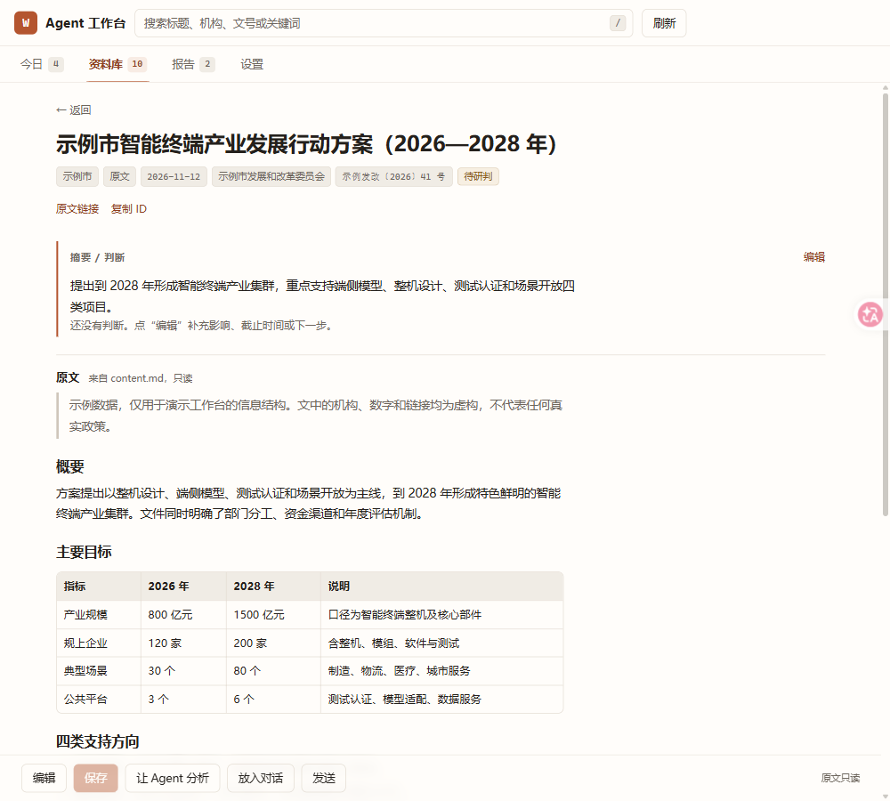
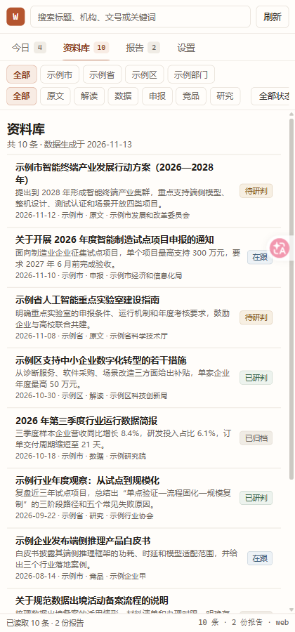

# Agent Workbench Template

**English.** A small, host-agnostic starter kit for building a personal workbench side panel. It ships four modes (Today, Library, Reports, Settings), two rows of combinable filters, a full-width list, a Markdown reader with a separate editable annotation layer, and a zero-dependency Node server. The UI is plain HTML/CSS/JS; one thin host interface keeps it portable across a browser, OpenChamber, DSH, OpenCode, or a custom desktop shell. All sample data is fictional. Code is MIT, docs and prompts are CC BY 4.0, sample data is CC0.

**中文。** 这是一个“照着做一个自己的侧栏工作台”的起步模板，不是某个行业的成品，也不是政策产品。它把工作台最容易被做坏的部分先定下来：4 个模式、两行可组合筛选、全宽列表、Markdown 阅读、原文只读 + 批注可写、一个宿主接口。示例数据全部是虚构的；接真实数据前请跑 `prompts/desensitize.md`。

适合两类人：

- **非技术知识工作者**：想有一个自己的“今日 / 资料库 / 报告 / 设置”侧栏，用来跟踪政策、客户、选题、候选人、研究文献或运营事件。照着 `SETUP.md` 启动，再按 `docs/customization.md` 改文案和数据即可。
- **开发者**：想改壳、接自己的宿主（OpenChamber / DSH / OpenCode / 桌面应用 / 编辑器插件）。读 `core/host.js`、`docs/host-api.md` 和 `adapters/README.md`。

> 截图在 `examples/screenshots/`：今日、资料库、详情、420px 窄栏。全部使用虚构数据。

## 5 分钟试用

要求：Node.js 18+，现代浏览器。**不需要 `npm install`，没有构建步骤。**

```bash
cd agent-workbench-template
node server/server.mjs
```

打开 <http://127.0.0.1:8787>。

也可以：

```bash
npm start          # 等价于 node server/server.mjs
PORT=9000 node server/server.mjs
```

Windows PowerShell 设置端口：

```powershell
$env:PORT=9000; node server/server.mjs
```

### 试这几件事

1. 在“今日”看统计、重点和动态。
2. 点第一行“示例市”、第二行“申报”，再选状态“在跟”，看条数变化。
3. 点一条打开详情；正文是 Markdown，原文只读。
4. 点“编辑”，改摘要/判断，`Ctrl/Cmd + S` 保存。
5. 打开 `workbench/annotations.json`，确认批注写进去了；再打开对应的 `items/<id>/content.md`，确认原文没变。
6. 切到“报告”，打开一份报告。
7. 切到“设置”，看数据位置、宿主能力和快捷键。
8. 把窗口缩到 420px，确认没有横向溢出，筛选条和动作条可以横向滑动。

## 你会得到什么

- **4 个模式**：今日 / 资料库 / 报告 / 设置。Tab 是“怎么工作”，不是“内容分类”。
- **两行筛选**：第一行第一维度 chips，第二行第二维度 chips；右侧状态、时间、条数；AND 组合；窄栏横向滚动不换行。
- **全宽列表 + 详情页**：没有左树、没有“更多”、没有营销首页；桌面行高 46px，一屏 12–18 条。
- **阅读 / 编辑分离**：详情默认 Markdown 预览；摘要和判断可编辑；原文 `content.md` 永远只读。
- **批注层**：保存到 `annotations.json`，通过 `PUT /api/annotations` 原子写入。
- **5 个底部动作**：编辑 / 保存 / 让 Agent 分析 / 放入对话 / 发送。Web 没有会话宿主时降级为复制 + 提示。
- **一个宿主接口**：`window.workbenchHost`，11 个方法；Web 适配器内置，其他宿主只写适配器。
- **零依赖 server**：静态文件 + 6 个 JSON API；路径穿越保护；默认 `127.0.0.1:8787`；端口可用 `PORT` 覆盖。
- **可抄的文档和提示词**：7 部件、数据合同、host API、定制指南、10 条弯路、建站/验收/脱敏提示词。

不包含：采集爬虫、PDF 解析、登录/多用户、数据库、全文搜索服务、自动版本历史。这些可以按 `docs/customization.md` 在外面加。

### 界面预览






## 目录

```text
agent-workbench-template/
  README.md
  SETUP.md                  # 从 clone 到跑起来
  LICENSE                   # MIT（代码）
  LICENSE-docs              # CC BY 4.0（文档/提示词）
  LICENSE-data              # CC0（示例数据）
  SECURITY.md
  config.example.json       # 改领域时复制成 workbench/config.json
  package.json              # 只有 start / check 脚本，无依赖
  core/
    index.html              # 壳
    styles.css              # 浅中性底 + 一个暖色强调
    app.js                  # 状态、4 Tab、筛选、列表、详情、编辑、键盘
    host.js                 # window.workbenchHost 接口 + web 适配器
    markdown.js             # Markdown 边界（html:false）
    vendor/
      markdown-it.umd.min.js
      markdown-it.LICENSE   # MIT
  server/
    server.mjs              # Node 内置模块；静态 + JSON API
  workbench/
    config.json             # 标签、两个维度、类型、状态、今日窗口
    index.json              # 10 条虚构条目
    annotations.json        # 空批注
    reports.json            # 2 份虚构报告
    items/ex-001/content.md # 每条正文，含标题/列表/链接/表格/引用
    ...
  adapters/
    README.md               # OpenChamber / Web / DSH / OpenCode 对照 + host 接口
    openchamber/            # 参考适配器（独立维护；若未包含，按 README 自行接）
  docs/
    design-principles.md    # 7 部件、Tab=mode、chip=filter、阅读/编辑分离
    data-contract.md        # config/index/annotations/reports schema
    host-api.md             # 11 个方法 + 各宿主映射
    customization.md        # 领域适配表；改标签/字段/Tab；加 agent 工具
    lessons.md              # 10 条弯路 + 正确做法
  prompts/
    build-workbench.md      # 完整建工作台提示词（短版 + 完整版）
    review-workbench.md     # 验收清单
    desensitize.md          # 脱敏清单
  examples/
    screenshots/.gitkeep
```

## 三个最重要的设计决定

### 1. Tab 是模式，不是内容分类

“今日”回答“现在先看什么”，“资料库”回答“全部东西在哪”，“报告”回答“我产出了什么”，“设置”回答“系统现在什么状态”。

“原文 / 解读 / 申报 / 竞品”是内容类型，放第二行 chip；“国家 / 省 / 市 / 区”是层级，放第一行 chip。新增分类时先问：它是不是一种新的工作方式？不是就别加 Tab。

### 2. 原文只读，批注可写

- 原文在 `workbench/items/<id>/content.md`，应用永远不写。
- 摘要/判断/状态写 `workbench/annotations.json`。
- 读取时：`annotation.summary || item.summary`，`annotation.status || item.status`。
- 保存只走 `PUT /api/annotations`，先写临时文件再原子替换。

这样重新采集原文不会覆盖你的判断，三个月后还能分清“文件说的”和“你说的”。

### 3. 窄栏优先，内容优先

全宽列表，不做左树；行式列表，不做卡片网格；第一屏直接是条目，不做欢迎页；一个暖色强调，不做大阴影和渐变。420px 能用的布局，宽屏自然能用。

## 换成你的领域

### 第 1 步：改标签和词表

编辑 `workbench/config.json`：`title`、`labels`、`dimensions`、`types`、`statuses`、`reports.types`。

### 第 2 步：换数据

- 在 `workbench/items/<id>/content.md` 放正文。
- 在 `workbench/index.json` 加条目，`content_path` 指向正文。
- 在 `workbench/reports.json` 放报告。
- 清空或保留 `annotations.json` 的示例批注。

### 第 3 步：按领域调整

`docs/customization.md` 给了政策、销售、招聘、研究、运营、内容六种领域的映射表，以及“改字段 / 改状态 / 改 Tab / 加 Agent 动作 / 换视觉”的具体步骤。

## 开发者路径

### 技术栈

- 浏览器：原生 HTML / CSS / JS，无框架、无打包、无运行时依赖。
- Markdown：vendored `markdown-it` UMD（MIT），`html: false`。
- 服务端：Node 18+ 内置模块（`http`、`fs`、`path`、`url`）。
- 数据：JSON + Markdown 文件。

### 读代码的顺序

1. `core/host.js`：11 个方法的合同和 web 适配器。
2. `core/app.js`：`state` → `renderAll()` → `renderTabs / renderFilters / renderMain`。
3. `core/styles.css`：变量、布局、三档断点。
4. `server/server.mjs`：路由、静态服务、PUT 校验、原子写入。
5. `docs/data-contract.md`：字段和读取优先级。

### 接一个宿主

适配器只需在 `host.js` 之前设置 `window.workbenchHost`：

```html
<script src="adapter-host.js"></script>
<script src="host.js"></script>
<script src="vendor/markdown-it.umd.min.js"></script>
<script src="markdown.js"></script>
<script src="app.js"></script>
```

最小实现见 `adapters/README.md` 的 “Host-file-backed” 示例；完整合同见 `docs/host-api.md`。

### Server API

| 方法 | 路径 | 说明 |
| --- | --- | --- |
| GET | `/api/config` | `workbench/config.json` |
| GET | `/api/index` | `workbench/index.json` |
| GET | `/api/annotations` | `workbench/annotations.json` |
| PUT | `/api/annotations` | 校验后原子写入 |
| GET | `/api/item/:id` | `{ item, content }` |
| GET | `/api/reports` | `workbench/reports.json` |
| GET | `/*` | `core/` 静态文件 |

### 测试

```bash
node --check server/server.mjs
node --check core/app.js
node --check core/host.js
node --check core/markdown.js
npm run check

# 启动后
curl http://127.0.0.1:8787/api/index
curl http://127.0.0.1:8787/api/annotations
curl http://127.0.0.1:8787/api/item/ex-001
```

数据校验脚本在 `docs/data-contract.md` 末尾；验收清单在 `prompts/review-workbench.md`。

## Web 版的限制

Web 适配器没有聊天宿主，所以：

- “让 Agent 分析”“放入对话”“发送”会把整理好的文本复制到剪贴板，并提示“Web 版没有会话宿主”。
- 剪贴板不可用时（非安全上下文、权限被拒），会提示复制失败；需要手动选择文本。
- 没有登录、权限、多用户和审计；默认只监听 `127.0.0.1`。
- 无法关闭浏览器标签页；`close` 是空实现。

这些限制在 `docs/host-api.md` 和 `adapters/README.md` 里都有说明。接上支持 `prompt` 的宿主后，三个动作才会真正“发送”。

## 文档索引

| 文档 | 读它做什么 |
| --- | --- |
| `SETUP.md` | 从 clone 到打开项目、安装扩展、授权、启动 server |
| `docs/design-principles.md` | 7 个部件、Tab=mode、chip=filter、阅读/编辑分离 |
| `docs/data-contract.md` | 四类数据的 schema、读取优先级、不变量、校验脚本 |
| `docs/host-api.md` | 11 个方法、各宿主映射、错误与降级 |
| `docs/customization.md` | 领域适配表、改字段/Tab/动作/视觉 |
| `docs/lessons.md` | 10 条弯路和正确做法 |
| `prompts/build-workbench.md` | 让 Agent 从零建一个工作台的提示词（短版 + 完整版） |
| `prompts/review-workbench.md` | 发布前验收清单 |
| `prompts/desensitize.md` | 公开前的脱敏清单 |

## 配套仓库

- [policy-monitor-workflow](https://github.com/Fanghj256/policy-monitor-workflow)：一套可离线运行的政策监测 workflow。跑完 demo 后，用 `scripts/export_workbench.py` 把输出转换成这个模板能直接读取的 `workbench/` 数据包。

## 许可

- 代码（`core/`、`server/`、`package.json` 等）：MIT，见 `LICENSE`。
- 文档与提示词（`README.md`、`SETUP.md`、`SECURITY.md`、`docs/`、`prompts/`、`adapters/README.md`）：CC BY 4.0，见 `LICENSE-docs`。
- 示例数据（`workbench/` 下的 JSON 和 Markdown）：CC0，见 `LICENSE-data`。
- `core/vendor/markdown-it.umd.min.js`：MIT，版权归其作者，见 `core/vendor/markdown-it.LICENSE`。

示例数据中的机构、人名、政策、数字和链接均为虚构；`example.com` 是保留域名，不指向真实页面。

