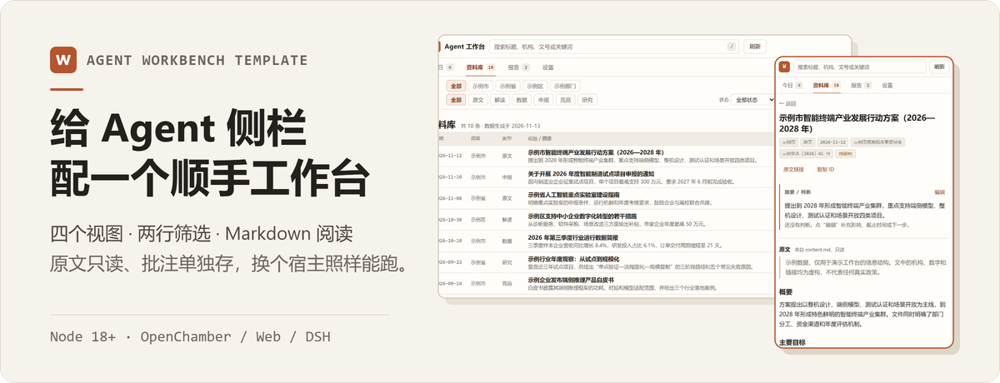
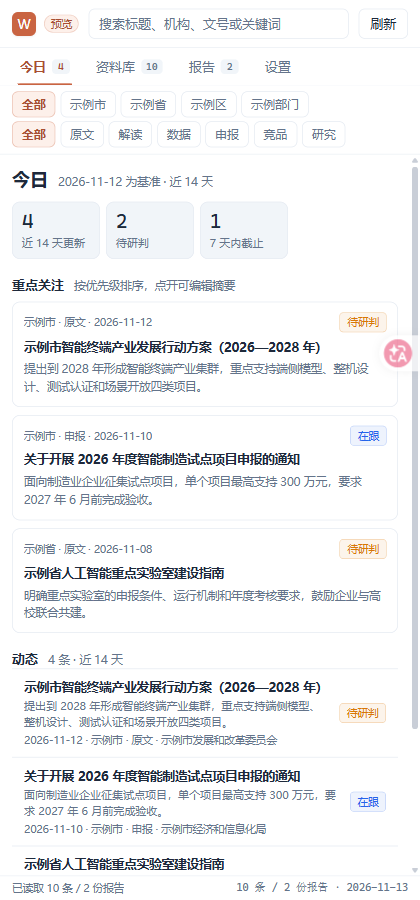
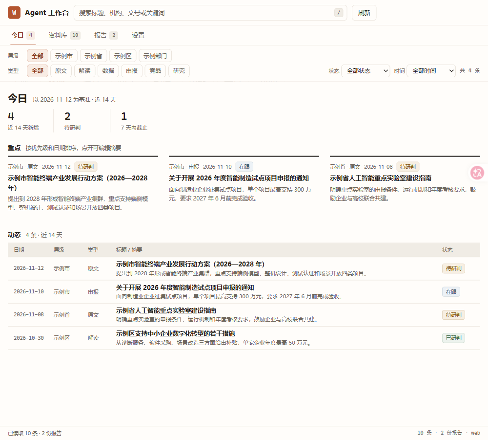
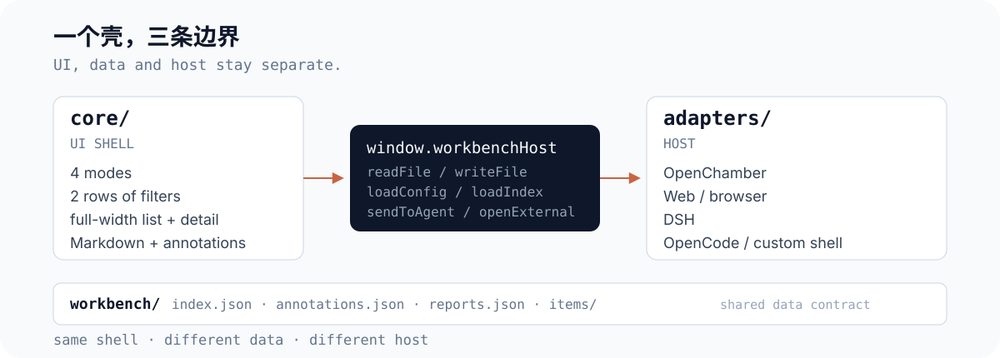

<p align="center">
  
</p>

# Agent Workbench Template

一个放进 Agent 侧栏就能用的轻量工作台模板。不需要编译打包，起一个静态服务就能跑，把“看列表、筛条件、读原文、写批注”这一层先搭稳。

`Node 18+` · `零构建依赖` · `支持 OpenChamber / Web / DSH / OpenCode`

## 打开后有这四页

<p align="center">
  
</p>

- **今日**：打开先看近 14 天新增、待研判数量和快截止的条目，省得每次从头翻列表。
- **资料库**：上面两行标签负责组合筛选，下面直接铺开全宽列表；缩到 420px 宽时，筛选条可以左右滑，不会把页面撑乱。
- **详情与批注**：原文渲染自 `content.md`，只能读不能改；你补充的摘要、判断和状态写进 `annotations.json`，哪怕以后重新导出一遍数据源，自己记下的判断也不会丢。
- **报告与设置**：集中查看整理好的周报、专题，也可以直接把当前条目发给对话里的 Agent，或者检查宿主接口状态。

<details>
<summary>查看更多界面截图（OpenChamber 420px 侧栏 &amp; 1000px 今日页）</summary>

<p align="center">
  
  
</p>

示例里的机构、政策和数字都是虚构数据。

</details>

## 5 分钟跑起来

不用装依赖，也不用跑打包命令：

```bash
node server/server.mjs
```

浏览器打开 <http://127.0.0.1:8787>，顺手试下面四步：

1. 在**今日**页看统计和焦点条目。
2. 切到**资料库**，第一行点“示例市”，第二行点“申报”，看列表筛选结果。
3. 点进任意一条，在上方批注框点**编辑**，改几句判断后按 `Ctrl/Cmd+S` 保存。
4. 把浏览器窗口拉窄到 **420px**：列表依然单列整齐，筛选条和底部动作条都能横向滑动。

保存后再去看 `workbench/annotations.json`，会发现批注已经写进去了，而对应的 `workbench/items/<id>/content.md` 一个字节都没有动。

## 适合谁，不适合谁

如果你正想在自己的 Agent 侧栏里跟进政策、客户线索、选题库、候选人或文献笔记，或者想找一个结构干净的壳子改造成自己的宿主插件，这个模板可以直接拿去改。

如果你要的是带登录注册、多用户权限、数据库全文检索的现成 SaaS 后台，它帮不上忙——这里没有左侧多级目录树，也没有后端数据库，只管把“浏览、筛选、阅读、批注、发给 Agent”这一层做好。

## 为什么要这样拆

- **Tab 按使用场景分，不按内容分类分**：用“今日 / 资料库 / 报告 / 设置”回答“我现在要干嘛”，至于“属于哪一级、什么类型”，全交给第二行的筛选标签，这样行业换了也不用改 Tab 结构。
- **原文和批注分开存**：抓取回来的 `content.md` 永远只读，人的判断写进 `annotations.json`（通过 `PUT /api/annotations` 原子写入）。过几个月回头看，哪些是原文写的、哪些是自己判断的，一眼能分清。
- **先保证 420px 窄栏好使**：行高、间距和横滑操作条都按侧栏宽度打磨过，窄屏顺手了，宽屏自然也干净。整体只留一个暖陶土色做焦点提醒，不堆阴影和渐变。

## 怎么接进你自己的项目

<p align="center">
  
</p>

界面逻辑全在 `core/` 里，它不直接碰任何特定平台的 API，只认一个很薄的 `window.workbenchHost`：

```js
window.workbenchHost = {
  loadIndex, loadAnnotations, saveAnnotations,
  loadItem, sendToAgent, openExternal, copyText
};
```

- **直接用网页版**：运行 `node server/server.mjs` 即可，内置 Web 适配。
- **装进 OpenChamber**：从 [`adapters/openchamber`](adapters/openchamber) 目录加载扩展，把项目根目录设为本仓库根目录并开启 `files / prompt / plugin` 权限；记得先启动 `node server/server.mjs`，点击本地原件链接时才能正常打开。
- **接 DSH / OpenCode 或自建桌面壳**：按 [docs/host-api.md](docs/host-api.md) 实现上面的几个方法，或者直接用 webview 嵌网页版。

## 换成你的内容

1. **改名称和筛选项**：编辑 `workbench/config.json` 里的 `title`、`labels`、`dimensions`、`types` 和 `statuses`。
2. **换数据文件**：把正文放进 `workbench/items/<id>/content.md`，条目索引写进 `workbench/index.json`（用 `content_path` 指过去），周报/专题写进 `reports.json`。
3. **对照不同场景微调**：[docs/customization.md](docs/customization.md) 里整理了政策、销售、招聘、研究、运营、内容六套字段映射，照着改配置就行，一般不用动 `core/` 的代码。

## 已知限制

- 纯 Web 版没有聊天窗口，点“让 Agent 分析 / 放入对话 / 发送”时会退回到复制到剪贴板并给出提示。
- 服务默认只监听 `127.0.0.1`，没有登录鉴权和多人协作锁。
- OpenChamber 扩展要求项目根目录就是模板根目录；如果宿主复制走扩展目录会导致相对路径失效，建议直接从本地目录加载。
- 数据全部是本地 JSON + Markdown 文件，没有内置全文检索引擎。

## 相关文档

| 文档 | 内容说明 |
|---|---|
| [SETUP.md](SETUP.md) | 从拉取仓库到装好扩展、启动服务的完整步骤 |
| [docs/design-principles.md](docs/design-principles.md) | 界面零件拆分、Tab 与筛选标签的取舍 |
| [docs/data-contract.md](docs/data-contract.md) | `config` / `index` / `annotations` / `reports` 的字段格式与校验 |
| [docs/customization.md](docs/customization.md) | 换成其他行业时的字段映射和改法 |
| [docs/lessons.md](docs/lessons.md) | 做这类侧栏工作台时踩过的 10 个坑 |
| [prompts/build-workbench.md](prompts/build-workbench.md) | 让 Agent 从头搭一个同款工作台的提示词 |
| [prompts/review-workbench.md](prompts/review-workbench.md) | 上线前对照检查用的验收清单 |

## 配套上游

如果你正需要把各地网站上的政策自动抓下来、整理成工作台能直接读取的目录，可以搭配 [policy-monitor-workflow](https://github.com/Fanghj256/policy-monitor-workflow) 使用。跑完它之后执行一次 `scripts/export_workbench.py`，生成的 `workbench/` 文件夹可以直接丢进这里。

## 许可

- 代码（`core/`、`server/`、`package.json` 等）：MIT，见 [LICENSE](LICENSE)。
- 文档与提示词：CC BY 4.0，见 [LICENSE-docs](LICENSE-docs)。
- 示例数据：CC0，见 [LICENSE-data](LICENSE-data)。
- `core/vendor/markdown-it.umd.min.js`：MIT，见 [core/vendor/markdown-it.LICENSE](core/vendor/markdown-it.LICENSE)。

示例中的机构、人名、政策名称和 `example.com` 链接均为虚构，仅作演示。

---

*English: a host-agnostic workbench starter kit for agent side panels. Four views, two-row combinable filters, a Markdown reader, and a separate writable annotation layer over read-only source files.*
