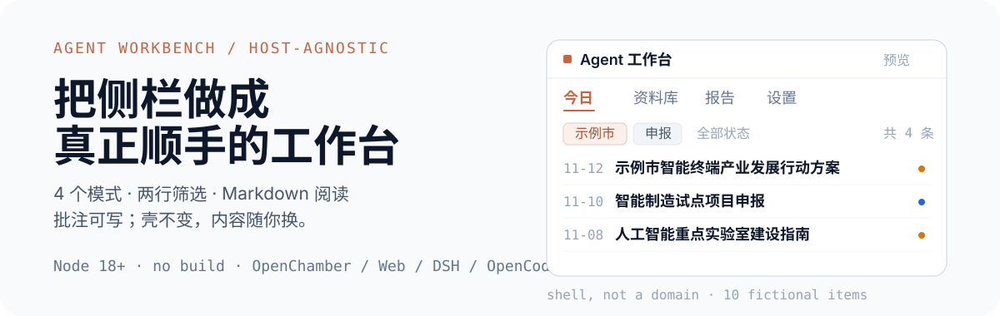
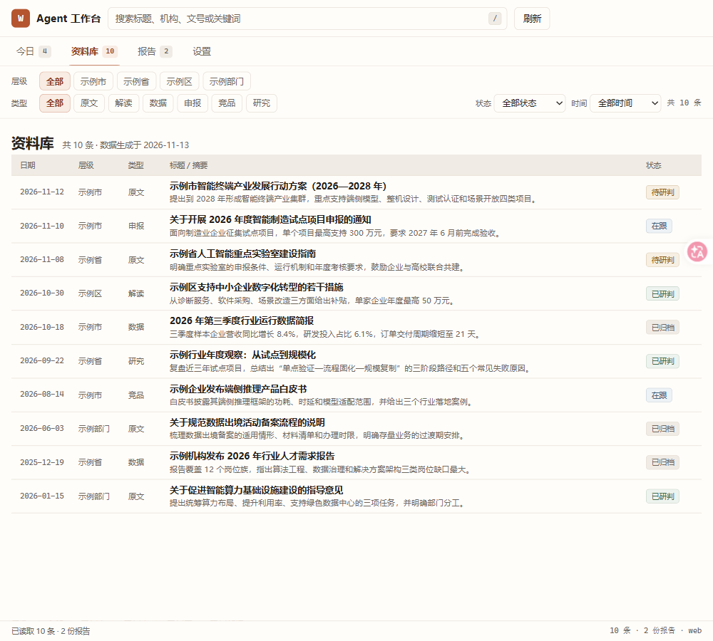
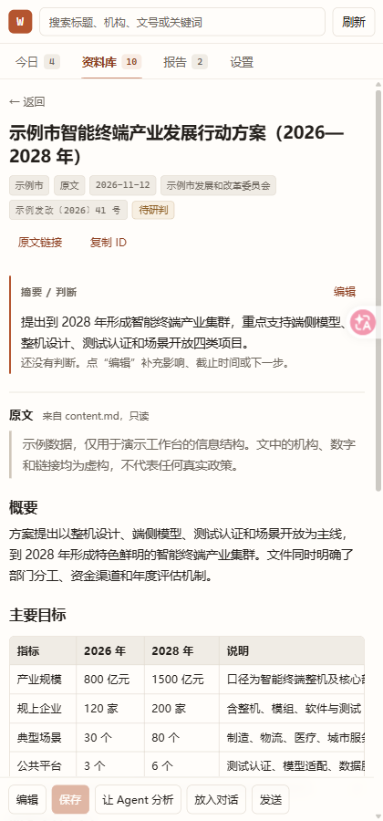

<p align="center">
  
</p>

# Agent Workbench Template

**在开源 agent 里，做一个真正顺手的侧栏工作台。**

不是某个行业的成品，也不是又一个 dashboard。它把工作台最容易被做坏的部分先定下来：4 个模式、两行可组合筛选、全宽列表、Markdown 阅读、原文只读 + 批注可写，以及一个很薄的宿主接口。

`Node 18+` · `no build` · `OpenChamber / Web / DSH / OpenCode`

## 5 分钟试用

不需要 `npm install`，没有构建步骤：

```bash
node server/server.mjs
```

打开 <http://127.0.0.1:8787>。试这四件事：

1. 在“今日”看统计、重点和动态。
2. 在“资料库”点第一行“示例市”、第二行“申报”，看条数变化。
3. 点一条打开详情；正文是 Markdown，点“编辑”改摘要/判断，`Ctrl/Cmd+S` 保存。
4. 把窗口缩到 420px：没有横向溢出，筛选条和动作条可以横向滑动。

保存后打开 `workbench/annotations.json` 会看到批注；对应的 `workbench/items/<id>/content.md` 不会被修改。

## 先看真实界面

<p align="center">
  
</p>

<p align="center">
  
  
</p>

截图全部使用虚构的示例市、示例部门、示例企业数据。

## 它是什么，不是什么

**适合**：想在自己的侧栏里跟踪政策、客户、选题、候选人、研究文献或运营事件的人；以及想改壳、接自己宿主的开发者。

**不适合**：想要一个固定行业成品、开箱即用的 CRM/知识库；或者需要登录、多用户、权限、数据库和全文检索的团队。这个模板只负责“看、筛、读、判断、发出去”这一层。

- 没有左树，没有“更多”，没有营销首页。
- 不包含采集爬虫、PDF 解析、登录/多用户、数据库、全文检索。
- 原文只读，批注单独存；重新采集不会覆盖你的判断。

## 三个设计决定

**1. Tab 是模式，不是内容分类。**  
“今日”回答“现在先看什么”，“资料库”回答“全部东西在哪”，“报告”回答“我产出了什么”，“设置”回答“系统现在什么状态”。层级和类型是第二行的 chip，不是新的 Tab。

**2. 原文只读，批注可写。**  
正文在 `workbench/items/<id>/content.md`，应用永远不写；摘要、判断、状态写 `workbench/annotations.json`。读取时 `annotation.summary || item.summary`，保存走 `PUT /api/annotations` 原子写入。三个月后还能分清“文件说的”和“你说的”。

**3. 窄栏优先，内容优先。**  
全宽列表、行式布局、桌面行高 46px；420px 能用的布局，宽屏自然能用。一个暖色强调，不做大阴影和渐变。

## 一个壳，三条边界

<p align="center">
  
</p>

- **core/**：4 个模式、筛选、列表、详情、Markdown、批注编辑；不直接读某个宿主的 API。
- **workbenchHost**：只暴露 `loadIndex`、`loadAnnotations`、`saveAnnotations`、`loadItem`、`sendToAgent`、`openExternal` 等薄接口。
- **adapters/**：Web、OpenChamber、DSH、OpenCode 各自实现同一个接口；数据和壳不动。
- **workbench/**：`index.json`、`annotations.json`、`reports.json`、`items/`，是唯一的数据合同。

完整接口和错误/降级约定见 [docs/host-api.md](docs/host-api.md)。OpenChamber 参考适配器在 [`adapters/openchamber`](adapters/openchamber)。

## 换成你的领域

1. **改标签和词表**：编辑 `workbench/config.json` 的 `title`、`labels`、`dimensions`、`types`、`statuses`、`reports.types`。
2. **换数据**：在 `workbench/items/<id>/content.md` 放正文，在 `workbench/index.json` 加条目，`content_path` 指向正文；报告放 `reports.json`。
3. **按领域调整**：政策、销售、招聘、研究、运营、内容六种映射表，以及“改字段 / 改状态 / 改 Tab / 加 Agent 动作”的步骤，见 [docs/customization.md](docs/customization.md)。

不需要改代码就能换掉标题、字段、筛选、状态和报告类型；需要新交互时再改 `core/`。

## 接一个宿主

- **Web**：内置，`node server/server.mjs` 即可。
- **OpenChamber**：从 `adapters/openchamber` 文件夹安装；项目根 = 模板仓库根；允许 `files / prompt / plugin`；先启动 `node server/server.mjs`，本地原件才能打开。
- **DSH / OpenCode / 桌面壳 / 编辑器插件**：实现 `window.workbenchHost`，或在 webview 里嵌 Web 版；接口见 [docs/host-api.md](docs/host-api.md)。

```js
window.workbenchHost = {
  loadIndex, loadAnnotations, saveAnnotations,
  loadItem, sendToAgent, openExternal, copyText
};
```

## 限制

- Web 版没有聊天宿主：分析/放入对话/发送会降级为复制到剪贴板并提示。
- 默认只监听 `127.0.0.1`，没有登录、权限、多用户、审计。
- OpenChamber 适配器要求项目根 = 模板仓库根；如果宿主复制扩展目录，插件相对路径会断，建议从本地文件夹安装。
- 没有数据库和全文检索；数据是 JSON + Markdown 文件。

## 文档

| 文档 | 读它做什么 |
|---|---|
| [SETUP.md](SETUP.md) | 从 clone 到打开项目、安装扩展、授权、启动 server |
| [docs/design-principles.md](docs/design-principles.md) | 7 个部件、Tab=mode、chip=filter、阅读/编辑分离 |
| [docs/data-contract.md](docs/data-contract.md) | config/index/annotations/reports 的 schema 与校验 |
| [docs/customization.md](docs/customization.md) | 领域映射、改字段/Tab/动作/视觉 |
| [docs/lessons.md](docs/lessons.md) | 10 条弯路和正确做法 |
| [prompts/build-workbench.md](prompts/build-workbench.md) | 让 Agent 从零建工作台的提示词 |
| [prompts/review-workbench.md](prompts/review-workbench.md) | 发布前验收清单 |

## 配套仓库

- [policy-monitor-workflow](https://github.com/Fanghj256/policy-monitor-workflow)：一套可离线运行的政策监测 workflow。跑完 demo 后，用 `scripts/export_workbench.py` 把输出转换成这个模板能直接读取的 `workbench/` 数据包。

## 许可

- 代码（`core/`、`server/`、`package.json` 等）：MIT，见 [LICENSE](LICENSE)。
- 文档与提示词：CC BY 4.0，见 [LICENSE-docs](LICENSE-docs)。
- 示例数据：CC0，见 [LICENSE-data](LICENSE-data)。
- `core/vendor/markdown-it.umd.min.js`：MIT，版权归其作者，见 [core/vendor/markdown-it.LICENSE](core/vendor/markdown-it.LICENSE)。

示例数据中的机构、人名、政策、数字和链接均为虚构；`example.com` 是保留域名，不指向真实页面。

---

*English: a host-agnostic starter kit for a personal workbench side panel. Four modes, combinable filters, a full-width list, a Markdown reader and a separate annotation layer. Plain HTML/CSS/JS, a zero-dependency server, and a thin host adapter for OpenChamber, web, DSH or OpenCode.*

